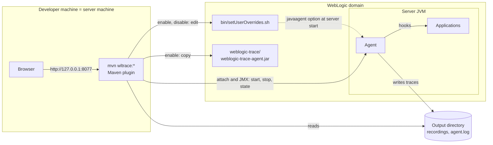
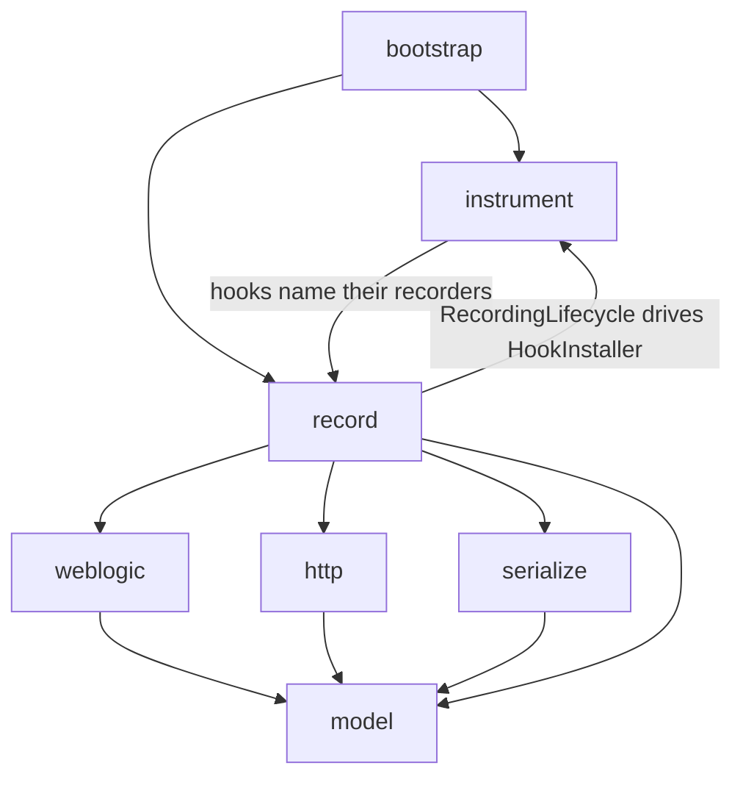

# Architecture

This document is the map of the repository: the parts of the system, the modules and what each one ships, the packages, how the pieces work together end to end, and the design rules the code follows. Each topic is covered in depth in its own document; this one links to them.

## Reading guide

| to understand | read |
| --- | --- |
| agents, bytecode, advice, class loaders, WorkContext, JMX, in plain language | [CONCEPTS.md](CONCEPTS.md) |
| how the agent gets into WebLogic, and how hooks, advice and recorders fit together | [FRAMEWORK.md](FRAMEWORK.md) |
| which WebLogic methods are hooked, and why those | [HOOKS.md](HOOKS.md) |
| how calls become traces, and how traces on other threads are linked | [TRACING.md](TRACING.md) |
| how arguments and results become JSON | [SERIALIZATION.md](SERIALIZATION.md) |
| how the Maven goals edit a domain and control the servers | [PLUGIN.md](PLUGIN.md) |
| the web server, lineage and the diagram | [VIEWER.md](VIEWER.md) |
| the files a recording is made of | [TRACE-FORMAT.md](../TRACE-FORMAT.md) |
| building, testing, releasing | [DEVELOPMENT.md](../DEVELOPMENT.md) |

## The system

Three parts:

- **The agent** runs inside each server JVM. It's idle until a recording starts; then it hooks WebLogic's entry points, records every call that passes through them, and writes one JSON file per trace.
- **The Maven plugin** runs on the same machine. `enable` and `disable` add and remove the agent in the domain; `start` finds the running servers, starts and stops recordings on them over JMX, and serves the viewer.
- **The viewer**, inside the plugin, reads the recordings from disk and draws them as a sequence diagram in the browser.

The agent and the viewer never talk to each other. The files are the only interface between them, described in [TRACE-FORMAT.md](../TRACE-FORMAT.md).

## Modules

| module | ships | depends on |
| --- | --- | --- |
| [`weblogic-trace-model`][model] | the trace format as plain Java classes, [`TraceJson`][TraceJson] (the one Jackson configuration), [`trace.schema.json`][schema] | Jackson |
| [`weblogic-trace-agent`][agent] | `weblogic-trace-agent.jar`, the `-javaagent` | model, ByteBuddy |
| [`weblogic-trace-viewer`][viewer] | the recording reader, lineage detection, the web server and page | model |
| [`weblogic-trace-maven-plugin`][plugin] | the goals `enable`, `start`, `disable` | viewer, and the agent jar as a file to install |

Maven builds them in that order. Everything compiles to Java 8 bytecode, so the agent runs on JDK 8 and JDK 21 servers and the plugin runs on a JDK 8 Maven.

## Packaging

**The agent jar** is self-contained, built by the shade plugin in [`weblogic-trace-agent/pom.xml`][agent-pom]:
- the agent's classes, the model's classes, and ByteBuddy and Jackson relocated under `ca.gc.cra.xz02.devops.wltrace.shaded`. Relocation means the agent's copies can't clash with the versions WebLogic or an application brings;
- the manifest: `Premain-Class` and `Agent-Class` [`AgentMain`][AgentMain], `Can-Retransform-Classes`, `Can-Redefine-Classes`;
- [`build.properties`][build-properties], with the version and a build timestamp. The plugin compares the timestamp in the installed jar with its own to tell whether the domain runs the current build.

**The plugin jar** shades the viewer, the model and Jackson (relocated the same way), so Maven's own Jackson never meets the viewer's. The agent is *not* shaded in: it's a plain dependency, resolved as its own artifact and copied into the domain by `enable` ([PLUGIN.md](PLUGIN.md#the-agent-jar)).

**The page** is four static files on the viewer's classpath, with no build step ([VIEWER.md](VIEWER.md#the-page)).

## Packages

All under `ca.gc.cra.xz02.devops.wltrace`.

| package | holds |
| --- | --- |
| **agent** | |
| [`agent.bootstrap`][bootstrap] | entry point, startup and object wiring, the inertness check, the log, the version stamp |
| [`agent.instrument`][instrument] | hooks, advice classes and the ByteBuddy installer: *where* and *how* to intercept |
| [`agent.record`][record] | recorders, span stacks, traces, the writer, the recording lifecycle and MBean: *what* to record |
| [`agent.weblogic`][weblogic] | every reflective read of a WebLogic internal: invocations, bean metadata, MBeans, WorkContext |
| [`agent.http`][http] | servlet request and response wrappers, generated at runtime, that copy the bodies |
| [`agent.serialize`][serialize] | the object-to-JSON walk, markers and limits |
| **model** | |
| [`model`][model-package] | the classes of the trace files, manifests and the viewer's index |
| **viewer** | |
| [`viewer.web`][viewer-web] | the HTTP server and its handlers; the page files are in the same package's resources |
| [`viewer.recording`][viewer-recording] | reading, merging and indexing recording directories |
| [`viewer.recording.lineage`][viewer-lineage] | linking values received to earlier values produced |
| **plugin** | |
| [`plugin.mojo`][mojo] | the three goals |
| [`plugin.domain`][domain] | the domain on disk: paths, platform, JDK, the overrides block, Node Manager |
| [`plugin.jvm`][jvm] | finding the server JVMs, talking to their agents, the domain's state |

Inside the agent, dependencies point one way:

`bootstrap` wires everything. `instrument` and `record` know each other at exactly two points: a hook names the recorder its advice calls, and [`RecordingLifecycle`][RecordingLifecycle] installs and removes the hooks. `weblogic`, `http` and `serialize` know nothing about recording. Every agent package except `serialize` writes to `bootstrap.AgentLog`.

## End to end

| step | what happens | covered in |
| --- | --- | --- |
| `wltrace:enable` | the jar is copied into the domain, and a `-javaagent` block is added to the overrides script | [PLUGIN.md](PLUGIN.md#the-domain-on-disk) |
| restart | each server loads the agent: bootstrap path, startup, MBean; nothing is instrumented | [FRAMEWORK.md](FRAMEWORK.md#loading-the-agent) |
| `wltrace:start` | the plugin finds the servers over attach and JMX, and serves the page | [PLUGIN.md](PLUGIN.md#finding-the-servers) |
| **Start** | one recording id goes to every server; each installs its hooks | [FRAMEWORK.md](FRAMEWORK.md#starting-and-stopping-a-recording) |
| a request | advice in WebLogic's methods calls the recorders; spans form traces | [HOOKS.md](HOOKS.md), [TRACING.md](TRACING.md) |
| a call returns | arguments, result or exception are serialized | [SERIALIZATION.md](SERIALIZATION.md) |
| a trace completes | it's queued and written as one file | [TRACING.md](TRACING.md#writing-traces-to-disk) |
| **Stop** | the writer drains, manifests are completed, hooks are removed | [FRAMEWORK.md](FRAMEWORK.md#starting-and-stopping-a-recording) |
| viewing | the viewer merges manifests, indexes traces, detects lineage, draws the diagram | [VIEWER.md](VIEWER.md) |
| `wltrace:disable` | the block and the jar are removed; recordings stay | [PLUGIN.md](PLUGIN.md#the-overrides-block) |

## Design rules

These shape the code. [CLAUDE.md](../../CLAUDE.md) lists them as rules for editing; here is why each exists.

1. **No WebLogic classes at compile time.** WebLogic's internals differ between releases and aren't a public API, and no WebLogic jar is available to the build. Every WebLogic type is matched by name and reached by reflection, only in [`agent.weblogic`][weblogic] and the hook definitions. Tests use stubs with the real names ([DEVELOPMENT.md](../DEVELOPMENT.md#testing)).
2. **Link only to bootstrap-visible JDK modules.** The agent lives on the bootstrap class path, which can't see platform modules like `java.sql` ([CONCEPTS.md](CONCEPTS.md#class-loaders)). Such types are recognised by name and called reflectively. [`BootstrapVisibilityTest`][BootstrapVisibilityTest] enforces it.
3. **Never throw into a business call.** The agent runs inside servers people are using. Every path from advice is guarded; a failure records less, never breaks the call ([FRAMEWORK.md](FRAMEWORK.md#safety-net)).
4. **Respect class loaders.** Each application has its own loaders, and a redeploy creates new ones. Caches key on the `Class` object (`ClassValue`), never on the class name alone, and hold no class alive. Classes are resolved through the loader of the object at hand.
5. **Advice is inlined.** Advice is copied into WebLogic's methods, so it's two static methods with one call each into [`TraceRuntime`][TraceRuntime]. That's the only static mutable state; everything else is an object built with its dependencies ([FRAMEWORK.md](FRAMEWORK.md#advice)).
6. **Raw capture.** The point is to see exactly what crossed each call. Every field is recorded with no masking or filtering; the only changes are markers, and every limit leaves a trace of what it cut ([SERIALIZATION.md](SERIALIZATION.md#the-rules)).
7. **Java 8 bytecode.** The same agent jar runs on JDK 8 (WebLogic 12.2.1.4) and JDK 21 (14.1.2), and the plugin runs on a JDK 8 Maven. `source`/`target` 1.8, build plugins that run on JDK 8, and the build passes on both JDKs.

The plugin also keeps a narrow footprint in the domain: it changes only the overrides script and `<domain>/weblogic-trace/`, and the agent instruments nothing while no recording is active.

[model]: ../../weblogic-trace-model
[agent]: ../../weblogic-trace-agent
[viewer]: ../../weblogic-trace-viewer
[plugin]: ../../weblogic-trace-maven-plugin
[agent-pom]: ../../weblogic-trace-agent/pom.xml
[schema]: ../../weblogic-trace-model/src/main/resources/trace.schema.json
[build-properties]: ../../weblogic-trace-agent/src/main/resources/ca/gc/cra/xz02/devops/wltrace/agent/bootstrap/build.properties
[TraceJson]: ../../weblogic-trace-model/src/main/java/ca/gc/cra/xz02/devops/wltrace/model/TraceJson.java
[AgentMain]: ../../weblogic-trace-agent/src/main/java/ca/gc/cra/xz02/devops/wltrace/agent/bootstrap/AgentMain.java
[TraceRuntime]: ../../weblogic-trace-agent/src/main/java/ca/gc/cra/xz02/devops/wltrace/agent/record/TraceRuntime.java
[RecordingLifecycle]: ../../weblogic-trace-agent/src/main/java/ca/gc/cra/xz02/devops/wltrace/agent/record/RecordingLifecycle.java
[BootstrapVisibilityTest]: ../../weblogic-trace-agent/src/test/java/ca/gc/cra/xz02/devops/wltrace/agent/bootstrap/BootstrapVisibilityTest.java
[bootstrap]: ../../weblogic-trace-agent/src/main/java/ca/gc/cra/xz02/devops/wltrace/agent/bootstrap
[instrument]: ../../weblogic-trace-agent/src/main/java/ca/gc/cra/xz02/devops/wltrace/agent/instrument
[record]: ../../weblogic-trace-agent/src/main/java/ca/gc/cra/xz02/devops/wltrace/agent/record
[weblogic]: ../../weblogic-trace-agent/src/main/java/ca/gc/cra/xz02/devops/wltrace/agent/weblogic
[http]: ../../weblogic-trace-agent/src/main/java/ca/gc/cra/xz02/devops/wltrace/agent/http
[serialize]: ../../weblogic-trace-agent/src/main/java/ca/gc/cra/xz02/devops/wltrace/agent/serialize
[model-package]: ../../weblogic-trace-model/src/main/java/ca/gc/cra/xz02/devops/wltrace/model
[viewer-web]: ../../weblogic-trace-viewer/src/main/java/ca/gc/cra/xz02/devops/wltrace/viewer/web
[viewer-recording]: ../../weblogic-trace-viewer/src/main/java/ca/gc/cra/xz02/devops/wltrace/viewer/recording
[viewer-lineage]: ../../weblogic-trace-viewer/src/main/java/ca/gc/cra/xz02/devops/wltrace/viewer/recording/lineage
[mojo]: ../../weblogic-trace-maven-plugin/src/main/java/ca/gc/cra/xz02/devops/wltrace/plugin/mojo
[domain]: ../../weblogic-trace-maven-plugin/src/main/java/ca/gc/cra/xz02/devops/wltrace/plugin/domain
[jvm]: ../../weblogic-trace-maven-plugin/src/main/java/ca/gc/cra/xz02/devops/wltrace/plugin/jvm
