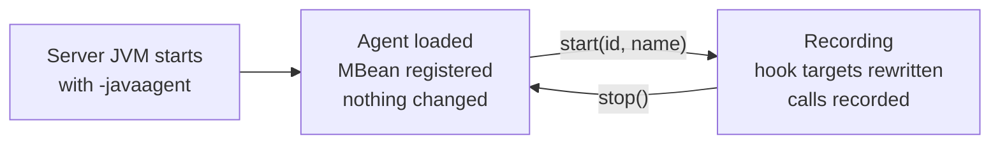
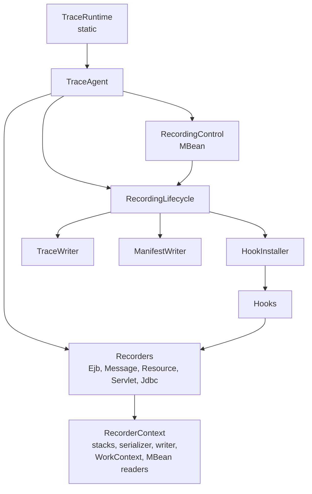
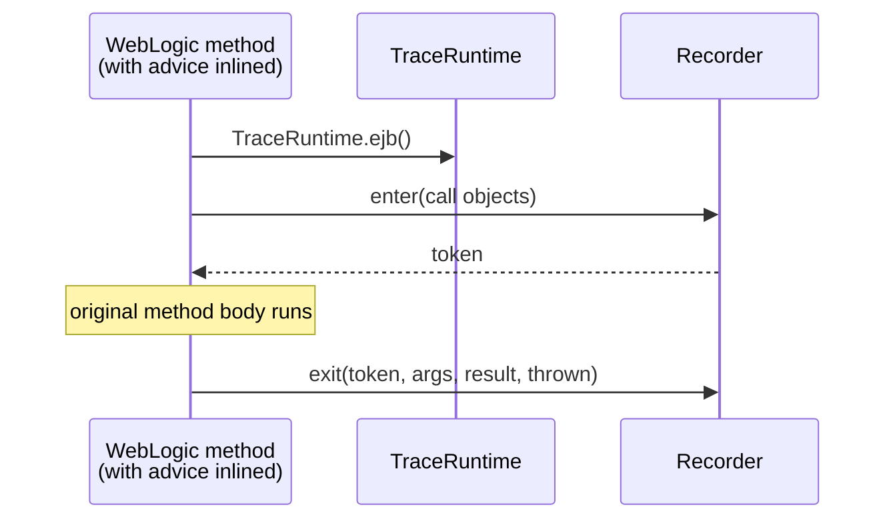

# The agent framework

This document explains how the agent gets into a WebLogic server and how it changes the server's classes while a recording runs: loading, startup, hooks, advice, recorders, and starting and stopping a recording. It doesn't cover what each hook records ([HOOKS.md](HOOKS.md)) or how calls become traces ([TRACING.md](TRACING.md)).

New to agents or bytecode? Read [CONCEPTS.md](CONCEPTS.md) first.

## The lifecycle



The agent has two states. **Idle**: it's loaded, its MBean answers, and every class in the server is exactly as WebLogic shipped it. **Recording**: the hooks' advice is inlined into WebLogic's entry points, and every call through them is recorded. A recording's start installs the advice; its stop removes it and restores the original bytecode.

## Loading the agent

The server is started with `-javaagent:<domain>/weblogic-trace/weblogic-trace-agent.jar=out=<dir>`, written into the domain by `wltrace:enable` ([PLUGIN.md](PLUGIN.md#the-overrides-block)). The JVM then calls [`AgentMain.premain`][AgentMain]:

1. **Append the jar to the bootstrap loader.** `Instrumentation.appendToBootstrapClassLoaderSearch` puts the agent's classes where every loader in the server can see them, so advice inlined into WebLogic classes and into application classes reaches the same [`TraceRuntime`][TraceRuntime]. [CONCEPTS.md](CONCEPTS.md#class-loaders) explains why that matters. `AgentMain` references no other agent class before this step, so everything after it loads from the bootstrap loader.
2. **Read the argument.** The only argument is `out=DIR`, where `agent.log` and the recordings go; anything else is refused. Without it, the agent uses `java.io.tmpdir/weblogic-trace`.
3. **Hand over to [`AgentStartup`][AgentStartup].**

If anything fails, `AgentMain` prints one line to stderr and the server starts without tracing. The agent never stops a server from starting.

The manifest, written by the shade plugin in [`weblogic-trace-agent/pom.xml`][agent-pom], names `AgentMain` as both `Premain-Class` and `Agent-Class` and declares `Can-Retransform-Classes`. Retransformation is what lets the agent change classes that are already loaded.

## Startup

[`AgentStartup.start`][AgentStartup] opens [`AgentLog`][AgentLog] (`<out>/agent.log`), builds every object the agent needs, publishes them through [`TraceRuntime`][TraceRuntime], registers the control MBean, and logs one of:

- `weblogic-trace-agent ready, recording off`
- `weblogic-trace-agent inert: <reason>`

Nothing is instrumented at startup.

### The object graph

`AgentStartup.assemble` builds plain objects with constructor injection. The shape:



[`TraceAgent`][TraceAgent] is a holder for the lifecycle, the control MBean and the five recorders. [`RecorderContext`][RecorderContext] is what every recorder shares.

### Inert agents

[`InertnessCheck`][InertnessCheck] decides whether the JVM is a WebLogic server the hooks fit:

- **Not WebLogic:** no `weblogic.home` property and no `weblogic/Server.class` on the class path.
- **Missing container classes:** any hook's target class isn't on the class path. The check looks the class file up as a resource and doesn't load it.

Every hook is required. An agent that can't install all of them installs none, so a recording is never silently missing part of what happened. An inert agent:
- logs `weblogic-trace-agent inert: <reason>`, naming the missing classes;
- still registers its MBean, whose `State` is `inert: <reason>`;
- refuses to start a recording with the same reason, which the page shows when **Start** is pressed.

## The three layers: hook, advice, recorder

Recording a call takes three pieces, each with one job:

| layer | job | lives in |
| --- | --- | --- |
| **Hook** | *Where* to intercept: which classes, which methods, which advice. | [`agent/instrument`][instrument], `*Hook` |
| **Advice** | The few instructions copied into the target method: on entry and on exit, pass the call's objects to a recorder. | [`agent/instrument`][instrument], `*Advice` |
| **Recorder** | *What* to record: read facts from the call, open and close a span, serialize the arguments and result. | [`agent/record`][record], `*Recorder` |

Why three? Advice runs inside WebLogic's own methods, compiled into someone else's class, so it must be tiny and can't hold state ([Advice](#advice)). The recorder is a normal object, so it can be large, tested and changed freely. The hook is a description, read once by [`HookInstaller`][HookInstaller].



### Hooks

A hook extends [`Hook`][Hook] and answers two questions:

- **`targetClassNames()`**: the WebLogic classes it needs, by name. The inertness check looks for them, and `agent.log` reports on each one when the hooks are installed. Empty for a hook that matches by annotation instead.
- **`bindings()`**: one or more [`AdviceBinding`][AdviceBinding]s, each a [`TypeMatcher`][TypeMatcher] (which classes, given the class *and* its loader), a ByteBuddy method matcher (which methods), and the advice class to inline.

[`ApplicationClassLoaders`][ApplicationClassLoaders] tells a WebLogic application loader from the server's own, for hooks that match application classes. [HOOKS.md](HOOKS.md) lists every hook.

### Advice

An advice class has two static methods:

```java
@Advice.OnMethodEnter(suppress = Throwable.class)
public static long enter(@Advice.Argument(0) Object invokable, ...) {
    return TraceRuntime.ejb().enter(invokable, clientObject, invocationWrapper);
}

@Advice.OnMethodExit(onThrowable = Throwable.class, suppress = Throwable.class)
public static void exit(@Advice.Enter long token, ..., @Advice.Thrown Throwable thrown) {
    TraceRuntime.ejb().exit(token, arguments, result, thrown);
}
```

(Shortened from [`SessionInvokerAdvice`][SessionInvokerAdvice].) The rules:

- **One call per method, into `TraceRuntime`.** No fields, lambdas or method references: the code is copied into a WebLogic class and must make sense there.
- **Parameters typed `Object`, with dynamic typing.** The agent compiles against no WebLogic or `javax.*` class.
- **`suppress = Throwable.class` on both methods.** If the advice ever throws, ByteBuddy swallows it, and the business method runs as if nothing was there.
- **The token links enter to exit.** `enter` returns a token; ByteBuddy hands it to `exit` through `@Advice.Enter`. `0` (`SpanRecorder.NOT_RECORDED`) means "nothing was opened", and `exit` does nothing.

One advice changes the call itself: [`ServletPipelineAdvice`][ServletPipelineAdvice] replaces the request and response arguments with wrappers that copy the bodies as they stream ([HOOKS.md](HOOKS.md#servlet-pipeline)).

### `TraceRuntime`, the single static entry

Inlined code can't receive objects through a constructor; all it can do is call a static method. [`TraceRuntime`][TraceRuntime] is that static method: it holds the one [`TraceAgent`][TraceAgent] and hands out its recorders (`ejb()`, `message()`, `resource()`, `servlet()`, `jdbc()`). It's the only static mutable state in the agent, set once at startup before any hook can run.

### Recorders

Each recorder extends [`SpanRecorder`][SpanRecorder], which fixes the shape of a recorded call:

- **`enter(first, second, third)`** returns at once with `NOT_RECORDED` if no recording is active. Otherwise it asks the subclass to `readFacts` from the objects the advice passed, and if they're recognised, opens a span on the thread's stack and returns its token.
- **`exit(token, arguments, result, thrown)`** finds the span by token, lets the facts describe it, records the outcome (arguments, then the result or exception), and closes it. Closing the outermost span hands the finished trace to the writer.

A subclass supplies `readFacts` (a [`SpanFacts`][SpanFacts] object holding what it learned at entry) and may override `recordOutcome`. [TRACING.md](TRACING.md) covers the stack, ids and linking; [HOOKS.md](HOOKS.md) covers what each recorder reads.

## Installing and removing hooks

[`HookInstaller`][HookInstaller] turns the hooks into one ByteBuddy `AgentBuilder`:

- **Retransformation, no shape changes.** `disableClassFormatChanges()` and `RedefinitionStrategy.RETRANSFORMATION` mean only method bodies change. That's what lets already-loaded WebLogic classes be rewritten at start and restored at stop.
- **An ignore list.** Classes in `weblogic.`, `oracle.`, `java.`, `javax.`, `sun.`, the agent's own package and the frameworks WebLogic embeds are never touched, except a hook's named targets. This keeps an annotation-based hook from rewriting server or library classes.
- **A second pass.** Asking ByteBuddy to describe a loaded class can load other classes as a side effect, and ByteBuddy skips those. After installing, `HookInstaller` retransforms any named target that is loaded but wasn't rewritten, and logs a warning for any that still isn't.

**`install()`** runs at recording start. It rewrites matching classes that are already loaded, and from then on each new matching class as it loads.

**`uninstall()`** runs at recording stop. It calls `reset` on the transformer, which retransforms every rewritten class back to its original bytecode.

[`InstrumentationListener`][InstrumentationListener] logs to `agent.log` each step: `hook target discovered`, `instrumented <class>`, `failed to instrument`, and the totals.

## Starting and stopping a recording

The plugin talks to the agent through the MBean `ca.gc.cra.xz02.devops.wltrace:type=Control` on the server's platform MBean server, implemented by [`RecordingControl`][RecordingControl] ([`RecordingControlMBean`][RecordingControlMBean]).

| operation or attribute | meaning |
| --- | --- |
| `start(id, name)` | Start a recording under the given id. One id is used on every server of the domain. |
| `stop()` | Stop the active recording; returns its id. |
| `State` | `ready`, `recording <id>` or `inert: <reason>` |
| `Enabled`, `RecordingId`, `RecordingName` | the active recording, if any |
| `TraceCount`, `WrittenTraces`, `QueuedTraces`, `DroppedTraces` | writer counters; `DroppedTraces` above zero means data was lost |
| `AgentBuild`, `ServerName`, `OutputDirectory` | identity of this agent |

[`RecordingLifecycle`][RecordingLifecycle] does the work, one call at a time:

| `start(id, name)` | `stop()` |
| --- | --- |
| 1. Refuse if inert. | 1. Clear the active recording. New calls are no longer recorded. |
| 2. Read the domain's deployments once, for every trace of the recording. | 2. Wait up to 5 s for queued traces to be written. |
| 3. Install the hooks. | 3. Complete this server's manifest with the trace and dropped counts. |
| 4. Write this server's manifest. | 4. Uninstall the hooks; the original bytecode is back. |
| 5. Make the recording active ([`ActiveRecording`][ActiveRecording]). | |

A failed install or uninstall is logged and doesn't throw. A recording that couldn't install its hooks simply sees no calls.

## Safety net

The agent runs inside production-like servers. It never changes the outcome of a business call.

| failure | what happens |
| --- | --- |
| the agent fails to start | one line on stderr; the server runs without tracing |
| advice throws | `suppress = Throwable.class`; the business method continues |
| a recorder fails at entry | `NOT_RECORDED`; the call runs unrecorded |
| a recorder fails at exit | the thread's open spans are dropped, the error is logged, and the next call starts clean |
| a WebLogic internal has changed shape | the reflective read returns null; the value is missing from the span, or the call isn't recorded, and a warning is logged once ([`AgentLog.warnOnce`][AgentLog]) |
| the writer can't keep up | the trace is dropped and counted; the request thread never waits ([TRACING.md](TRACING.md#writing-traces-to-disk)) |
| the log can't be written | log lines go to stderr; a logging failure is swallowed |

[agent-pom]: ../../weblogic-trace-agent/pom.xml
[AgentMain]: ../../weblogic-trace-agent/src/main/java/ca/gc/cra/xz02/devops/wltrace/agent/bootstrap/AgentMain.java
[AgentStartup]: ../../weblogic-trace-agent/src/main/java/ca/gc/cra/xz02/devops/wltrace/agent/bootstrap/AgentStartup.java
[AgentLog]: ../../weblogic-trace-agent/src/main/java/ca/gc/cra/xz02/devops/wltrace/agent/bootstrap/AgentLog.java
[InertnessCheck]: ../../weblogic-trace-agent/src/main/java/ca/gc/cra/xz02/devops/wltrace/agent/bootstrap/InertnessCheck.java
[instrument]: ../../weblogic-trace-agent/src/main/java/ca/gc/cra/xz02/devops/wltrace/agent/instrument
[Hook]: ../../weblogic-trace-agent/src/main/java/ca/gc/cra/xz02/devops/wltrace/agent/instrument/Hook.java
[AdviceBinding]: ../../weblogic-trace-agent/src/main/java/ca/gc/cra/xz02/devops/wltrace/agent/instrument/AdviceBinding.java
[TypeMatcher]: ../../weblogic-trace-agent/src/main/java/ca/gc/cra/xz02/devops/wltrace/agent/instrument/TypeMatcher.java
[ApplicationClassLoaders]: ../../weblogic-trace-agent/src/main/java/ca/gc/cra/xz02/devops/wltrace/agent/instrument/ApplicationClassLoaders.java
[HookInstaller]: ../../weblogic-trace-agent/src/main/java/ca/gc/cra/xz02/devops/wltrace/agent/instrument/HookInstaller.java
[InstrumentationListener]: ../../weblogic-trace-agent/src/main/java/ca/gc/cra/xz02/devops/wltrace/agent/instrument/InstrumentationListener.java
[SessionInvokerAdvice]: ../../weblogic-trace-agent/src/main/java/ca/gc/cra/xz02/devops/wltrace/agent/instrument/SessionInvokerAdvice.java
[ServletPipelineAdvice]: ../../weblogic-trace-agent/src/main/java/ca/gc/cra/xz02/devops/wltrace/agent/instrument/ServletPipelineAdvice.java
[record]: ../../weblogic-trace-agent/src/main/java/ca/gc/cra/xz02/devops/wltrace/agent/record
[TraceRuntime]: ../../weblogic-trace-agent/src/main/java/ca/gc/cra/xz02/devops/wltrace/agent/record/TraceRuntime.java
[TraceAgent]: ../../weblogic-trace-agent/src/main/java/ca/gc/cra/xz02/devops/wltrace/agent/record/TraceAgent.java
[RecorderContext]: ../../weblogic-trace-agent/src/main/java/ca/gc/cra/xz02/devops/wltrace/agent/record/RecorderContext.java
[SpanRecorder]: ../../weblogic-trace-agent/src/main/java/ca/gc/cra/xz02/devops/wltrace/agent/record/SpanRecorder.java
[SpanFacts]: ../../weblogic-trace-agent/src/main/java/ca/gc/cra/xz02/devops/wltrace/agent/record/SpanFacts.java
[RecordingControl]: ../../weblogic-trace-agent/src/main/java/ca/gc/cra/xz02/devops/wltrace/agent/record/RecordingControl.java
[RecordingControlMBean]: ../../weblogic-trace-agent/src/main/java/ca/gc/cra/xz02/devops/wltrace/agent/record/RecordingControlMBean.java
[RecordingLifecycle]: ../../weblogic-trace-agent/src/main/java/ca/gc/cra/xz02/devops/wltrace/agent/record/RecordingLifecycle.java
[ActiveRecording]: ../../weblogic-trace-agent/src/main/java/ca/gc/cra/xz02/devops/wltrace/agent/record/ActiveRecording.java
