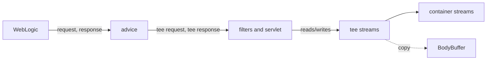

# Hooks

This document lists the hooks the agent installs: which WebLogic method each one intercepts, why that method, what gets recorded, and what the agent reads from WebLogic to describe the call. How hooks are installed is in [FRAMEWORK.md](FRAMEWORK.md); how the recorded calls become traces is in [TRACING.md](TRACING.md).

## Why WebLogic's internals

The agent hooks the container, not the applications. Every EJB call, message delivery and HTTP request passes through a handful of WebLogic methods before any application code runs. Hooking those few methods records every bean of every application without knowing their classes, and without changing a single deployed file.

The cost is that these are internal classes: not a public API, and free to change in a WebLogic patch or release. So the agent names them in one place (the `*Hook` classes), reads them only through reflection (the [`agent/weblogic`][weblogic] classes), and never breaks a call when they change: it goes inert, or records less, and says so in `agent.log`.

## Summary

| hook | intercepts | advice | recorder | span |
| --- | --- | --- | --- | --- |
| [Session invokers](#session-invokers) | `SessionLocalMethodInvoker.invoke`, `SessionRemoteMethodInvoker.invoke` | [`SessionInvokerAdvice`][SessionInvokerAdvice] | [`EjbRecorder`][EjbRecorder] | `EJB`, invocation `LOCAL`/`REMOTE` |
| [Message-driven listener](#message-driven-listener) | `MDListener.onMessage` | [`MessageListenerAdvice`][MessageListenerAdvice] | [`MessageRecorder`][MessageRecorder] | `EJB`, invocation `MESSAGE` |
| [Servlet pipeline](#servlet-pipeline) | `FilterChainImpl.doFilter`, `ServletStubImpl.execute` | [`ServletPipelineAdvice`][ServletPipelineAdvice] | [`ServletRecorder`][ServletRecorder] | `HTTP` |
| [Resource classes](#resource-classes) | public methods of application classes annotated `@Path` or `@WebService` | [`ResourceAdvice`][ResourceAdvice] | [`ResourceRecorder`][ResourceRecorder] | `HTTP`, layer `jaxrs`/`jaxws` |
| [JDBC wrappers](#jdbc-wrappers) | `execute*` and `set*` of WebLogic's statement wrappers, its result-set wrapper | [`JdbcStatementAdvice`][JdbcStatementAdvice] | [`JdbcRecorder`][JdbcRecorder] | `SQL` |

The WebLogic classes are in `weblogic.ejb.container.internal`, `weblogic.servlet.internal` and `weblogic.jdbc.wrapper`. Every hook is required: if any target class is missing, the agent goes inert and names it ([FRAMEWORK.md](FRAMEWORK.md#inert-agents)).

## Session invokers

[`SessionInvokerHook`][SessionInvokerHook]

**Intercepts** the static five-argument `invoke` of `weblogic.ejb.container.internal.SessionLocalMethodInvoker` and `SessionRemoteMethodInvoker`.

**Why there.** Every business-interface call into a session bean goes through one of these two methods: stateless, stateful, singleton, EJB 2.x, local view or remote view. One hook covers them all.

**Records** one `EJB` span per call: the bean, method, signature, interface, local or remote, transaction attribute, the arguments, and the result or exception.

**Reads from WebLogic:**
- [`SessionInvocation`][SessionInvocation]: the method descriptor (application, module, EJB name, `java.lang.reflect.Method`, transaction attribute) from the invocation wrapper; the bean class from the client object's `beanInfo`; whether the call is local; which business interface the call came through.
- [`BeanMetadataResolver`][BeanMetadataResolver]: the application, module, bean type and JNDI names, once per bean class (see [Reading WebLogic](#reading-weblogic)).

**If it changes:** if the descriptor or bean class can't be read, the call isn't recorded and `agent.log` gets one warning.

## Message-driven listener

[`MessageListenerHook`][MessageListenerHook]

**Intercepts** `weblogic.ejb.container.internal.MDListener.onMessage(Message)`.

**Why there.** Every JMS message WebLogic delivers to a message-driven bean goes through this method, on the delivery thread, before the bean's `onMessage`.

**Records** one `EJB` span with invocation `MESSAGE`: the bean, its destination, the transaction attribute, and the message as the one argument. The message is recorded through the JMS API (headers, properties, body), not as the vendor object ([SERIALIZATION.md](SERIALIZATION.md#jms-messages)).

The delivery usually starts a new trace on its own thread. That trace is linked to the call that sent the message through WorkContext ([TRACING.md](TRACING.md#work-that-continues-on-another-thread)).

**Reads from WebLogic:** [`MessageDelivery`][MessageDelivery]: the listener's private `info` field (`MessageDrivenBeanInfo`), and from it the bean class, its loader, the destination name and the `onMessage` transaction attribute.

**If it changes:** the delivery isn't recorded, with one warning.

## Servlet pipeline

[`ServletPipelineHook`][ServletPipelineHook]

**Intercepts** `weblogic.servlet.internal.FilterChainImpl.doFilter(request, response)` and `weblogic.servlet.internal.ServletStubImpl.execute(request, response)`.

**Why there.** These are the first points in WebLogic's request pipeline that receive the servlet API objects. A web application with filters enters through `FilterChainImpl`, one without enters through `ServletStubImpl`. Whatever request and response are passed on from here is what every filter and the servlet see.

**Records** one `HTTP` span per request: method, URI parts, query, headers, status, both bodies, the remote address, and the exception if the chain threw. The span is usually the root of its trace.

**Capturing bodies.** The application reads the request body and writes the response body through streams the agent never sees, so the advice swaps the request and response for wrappers on the way in:

- [`TeeClasses`][TeeClasses] generates, with ByteBuddy at runtime, subclasses of `HttpServletRequestWrapper`, `HttpServletResponseWrapper`, `ServletInputStream` and `ServletOutputStream`. They're generated rather than compiled because the agent can't compile against the servlet API, and each application's loader may have its own copy of it. [`TeeClassCache`][TeeClassCache] keeps one set per servlet API.
- [`TeeSupport`][TeeSupport] is what the generated methods call. Every byte read or written is forwarded to the container's stream and copied into a [`BodyBuffer`][BodyBuffer], which keeps up to 64 MiB per body and counts the rest. A `getWriter()` response is copied as characters.
- [`HttpCapture`][HttpCapture] holds one request's state. At exit, [`HttpInfoReader`][HttpInfoReader] reads the rest from the original request and response, drains a request body the application didn't read, and decides each body's encoding (text with a charset, or base64).

**Not recorded twice.** `FilterChainImpl.doFilter` runs again for every filter in the chain. [`ServletRecorder`][ServletRecorder] unwraps the incoming request ([`ServletApi`][ServletApi]); if it's the same container request an open HTTP span already holds, nothing new is opened.

**Limits.** A container error page written after the pipeline returns (`sendError`, an uncaught exception) isn't seen. The span says so in `responseBodyNote`. If the wrappers can't be generated, the request is still recorded, with headers and status but no bodies.

## Resource classes

[`ResourceHook`][ResourceHook]

**Intercepts** every public instance method of a class that is annotated `javax.ws.rs.Path` (JAX-RS) or `javax.jws.WebService` (JAX-WS) and is defined by an application class loader.

**Why there.** The HTTP span shows the raw request; this span shows which resource method handled it and with which Java arguments. It's the one hook that rewrites application classes, so it has the strictest matching:
- only classes loaded by a WebLogic application loader ([`ApplicationClassLoaders`][ApplicationClassLoaders]). A server class with the same annotations is skipped, and logged once;
- not classes that are also EJBs (`@Stateless`, `@Stateful`, `@Singleton`, `@MessageDriven`), which the session invokers already record;
- no constructors, static, synthetic or bridge methods.

**Records** one `HTTP` span with `layer` `jaxrs` or `jaxws`, under the request's span: resource class, method and signature, the arguments and the result.

**How the method is known.** The advice passes a constant `"<class>|<method>|<descriptor>"` string, built by ByteBuddy into each rewritten method. [`MethodResolver`][MethodResolver] turns it back into a method once per class, and [`ResourceLayers`][ResourceLayers] picks the layer from the annotation.

WebLogic loads each application class in an analysis loader before the real one, so the same class can appear twice as `instrumented` in `agent.log`. That's expected.

## JDBC wrappers

[`JdbcStatementHook`][JdbcStatementHook]

**Intercepts** three things on WebLogic's JDBC wrappers in `weblogic.jdbc.wrapper`:

| what | where | advice |
| --- | --- | --- |
| statement execution | public `execute*` of `Statement`, `PreparedStatement`, `CallableStatement` | `JdbcStatementAdvice.Execute` |
| parameter binding | `set*(int, ...)`, `addBatch`, `clearParameters` of the same | `JdbcStatementAdvice.Bind` |
| rows read | `ResultSet.postInvocationHandler`. The wrapper has no `next()` of its own; the generated subclass routes every call through this handler. | `JdbcStatementAdvice.RowRead` |

**Why there.** Every connection from a WebLogic data source hands out these wrappers, whatever the driver, so one hook sees all SQL from every application, including what JPA generates.

**Records** one `SQL` span per execution: data source, JNDI names, URL, database product, statement type, the SQL, its positional parameters (or every batch), and the update count, or whether a result set came back and how many rows the application read.

**How parameters are kept.** `bind` runs on each `set*` and stores the value per statement in [`JdbcRecorder`][JdbcRecorder] (weakly held, so a forgotten statement isn't kept alive). `execute*` takes the stored values into the span. Rows are counted as the application calls `next()` on the result set.

**Reads from WebLogic:**
- [`JdbcWrappers`][JdbcWrappers]: the pool name from the statement's connection, the SQL from its `sql` field.
- [`DataSourceCatalog`][DataSourceCatalog]: JNDI names, URL and database product from the data source's MBeans, once per pool.

## Reading WebLogic

The recorders never touch a WebLogic class directly. These classes in [`agent/weblogic`][weblogic] do, all by reflection, and all return null or empty on failure:

| class | reads | used for |
| --- | --- | --- |
| [`Reflection`][Reflection] | public methods and fields by name, up the class hierarchy | everything below |
| [`SessionInvocation`][SessionInvocation] | the invocation wrapper and client object of a session call | EJB spans |
| [`MessageDelivery`][MessageDelivery] | `MDListener.info` | MDB spans |
| [`BeanInfoReader`][BeanInfoReader] | WebLogic's `BeanInfo`: business interfaces, JNDI names, bean type | bean metadata |
| [`BeanMetadataResolver`][BeanMetadataResolver] | the `*EJBRuntime` MBeans and a `java:global` JNDI lookup to confirm the bean | `app`, `module`, `beanType`, `jndiNames`, cached per class |
| [`RuntimeMBeans`][RuntimeMBeans] | finding WebLogic's runtime MBean server; EJB runtimes; the domain's deployments | metadata, the deployments on every trace |
| [`DataSourceCatalog`][DataSourceCatalog] | `JDBCSystemResource` and `JDBCDataSourceRuntime` MBeans | SQL spans, cached per pool |
| [`JdbcWrappers`][JdbcWrappers] | statement and result-set wrapper fields | SQL spans |
| [`ServerRuntime`][ServerRuntime] | `weblogic.Name`; the current subject; the HTTP session of the current request | `serverName`, `principal`, `httpSessionId` on each trace |
| [`WorkContextPropagation`][WorkContextPropagation] | `weblogic.workarea.WorkContextMap` | linking traces across threads |

**Principal and session.** Each trace records who made the call and their HTTP session. For an HTTP request they come from the request ([`ServletApi`][ServletApi]); for anything else, from WebLogic's current security subject and, on a request thread, the request's session ([`ServerRuntime`][ServerRuntime]).

## When a hook stops working

After a WebLogic patch or upgrade, `agent.log` tells you which internal moved:

| line | means | look at |
| --- | --- | --- |
| `weblogic-trace-agent inert: WebLogic without the expected container classes [...]` | a target class is gone or renamed; nothing is recorded | the hook naming that class |
| `hook targets loaded but not instrumented (no method of the expected shape)` | the class is there, but the method's name or arguments changed | the method matcher in that hook's `bindings()` |
| a `WARN` such as `session invoker hook: invocation objects not recognised`, `runtime MBeans unreachable`, `WorkContext propagation failed` | a field, method or MBean a reader uses changed; those calls are recorded with less detail, or not at all | the reader in the table above |

To find the new shape, take a thread dump (`jcmd <pid> Thread.print`) while a request is inside the application code, and look for the WebLogic frames below it.

## Adding a hook

1. **Find the choke point.** One WebLogic method that every call of the kind passes through, with the objects you need as arguments. A thread dump taken while the application code is running shows the frames.
2. **Write the reader** in [`agent/weblogic`][weblogic]: reflection only, null on failure, no WebLogic types in signatures.
3. **Write the facts and the recorder** in [`agent/record`][record]: a [`SpanFacts`][SpanFacts] subclass and a [`SpanRecorder`][SpanRecorder] subclass. Add an accessor to [`TraceRuntime`][TraceRuntime] and a field to [`TraceAgent`][TraceAgent].
4. **Write the advice**: two static methods, one call each into `TraceRuntime`, `suppress = Throwable.class` ([FRAMEWORK.md](FRAMEWORK.md#advice)).
5. **Write the hook**: a [`Hook`][Hook] subclass naming the target classes and binding the advice. Register it in [`AgentStartup`][AgentStartup]. Its target classes become required: if they're missing, the agent goes inert.
6. **Add stubs and tests**: a stub of the WebLogic class under `weblogic-trace-agent/src/test/java/weblogic/`, named like the real one, and a test that installs the hook on the test JVM ([DEVELOPMENT.md](../DEVELOPMENT.md#testing)).
7. **Check it on a real domain** ([DEVELOPMENT.md](../DEVELOPMENT.md#checking-a-change-on-a-server)) and add a section to this document.

[weblogic]: ../../weblogic-trace-agent/src/main/java/ca/gc/cra/xz02/devops/wltrace/agent/weblogic
[record]: ../../weblogic-trace-agent/src/main/java/ca/gc/cra/xz02/devops/wltrace/agent/record
[AgentStartup]: ../../weblogic-trace-agent/src/main/java/ca/gc/cra/xz02/devops/wltrace/agent/bootstrap/AgentStartup.java
[Hook]: ../../weblogic-trace-agent/src/main/java/ca/gc/cra/xz02/devops/wltrace/agent/instrument/Hook.java
[ApplicationClassLoaders]: ../../weblogic-trace-agent/src/main/java/ca/gc/cra/xz02/devops/wltrace/agent/instrument/ApplicationClassLoaders.java
[SessionInvokerHook]: ../../weblogic-trace-agent/src/main/java/ca/gc/cra/xz02/devops/wltrace/agent/instrument/SessionInvokerHook.java
[SessionInvokerAdvice]: ../../weblogic-trace-agent/src/main/java/ca/gc/cra/xz02/devops/wltrace/agent/instrument/SessionInvokerAdvice.java
[MessageListenerHook]: ../../weblogic-trace-agent/src/main/java/ca/gc/cra/xz02/devops/wltrace/agent/instrument/MessageListenerHook.java
[MessageListenerAdvice]: ../../weblogic-trace-agent/src/main/java/ca/gc/cra/xz02/devops/wltrace/agent/instrument/MessageListenerAdvice.java
[ServletPipelineHook]: ../../weblogic-trace-agent/src/main/java/ca/gc/cra/xz02/devops/wltrace/agent/instrument/ServletPipelineHook.java
[ServletPipelineAdvice]: ../../weblogic-trace-agent/src/main/java/ca/gc/cra/xz02/devops/wltrace/agent/instrument/ServletPipelineAdvice.java
[ResourceHook]: ../../weblogic-trace-agent/src/main/java/ca/gc/cra/xz02/devops/wltrace/agent/instrument/ResourceHook.java
[ResourceAdvice]: ../../weblogic-trace-agent/src/main/java/ca/gc/cra/xz02/devops/wltrace/agent/instrument/ResourceAdvice.java
[JdbcStatementHook]: ../../weblogic-trace-agent/src/main/java/ca/gc/cra/xz02/devops/wltrace/agent/instrument/JdbcStatementHook.java
[JdbcStatementAdvice]: ../../weblogic-trace-agent/src/main/java/ca/gc/cra/xz02/devops/wltrace/agent/instrument/JdbcStatementAdvice.java
[TraceRuntime]: ../../weblogic-trace-agent/src/main/java/ca/gc/cra/xz02/devops/wltrace/agent/record/TraceRuntime.java
[TraceAgent]: ../../weblogic-trace-agent/src/main/java/ca/gc/cra/xz02/devops/wltrace/agent/record/TraceAgent.java
[SpanRecorder]: ../../weblogic-trace-agent/src/main/java/ca/gc/cra/xz02/devops/wltrace/agent/record/SpanRecorder.java
[SpanFacts]: ../../weblogic-trace-agent/src/main/java/ca/gc/cra/xz02/devops/wltrace/agent/record/SpanFacts.java
[EjbRecorder]: ../../weblogic-trace-agent/src/main/java/ca/gc/cra/xz02/devops/wltrace/agent/record/EjbRecorder.java
[MessageRecorder]: ../../weblogic-trace-agent/src/main/java/ca/gc/cra/xz02/devops/wltrace/agent/record/MessageRecorder.java
[ServletRecorder]: ../../weblogic-trace-agent/src/main/java/ca/gc/cra/xz02/devops/wltrace/agent/record/ServletRecorder.java
[ResourceRecorder]: ../../weblogic-trace-agent/src/main/java/ca/gc/cra/xz02/devops/wltrace/agent/record/ResourceRecorder.java
[JdbcRecorder]: ../../weblogic-trace-agent/src/main/java/ca/gc/cra/xz02/devops/wltrace/agent/record/JdbcRecorder.java
[MethodResolver]: ../../weblogic-trace-agent/src/main/java/ca/gc/cra/xz02/devops/wltrace/agent/record/MethodResolver.java
[ResourceLayers]: ../../weblogic-trace-agent/src/main/java/ca/gc/cra/xz02/devops/wltrace/agent/record/ResourceLayers.java
[Reflection]: ../../weblogic-trace-agent/src/main/java/ca/gc/cra/xz02/devops/wltrace/agent/weblogic/Reflection.java
[SessionInvocation]: ../../weblogic-trace-agent/src/main/java/ca/gc/cra/xz02/devops/wltrace/agent/weblogic/SessionInvocation.java
[MessageDelivery]: ../../weblogic-trace-agent/src/main/java/ca/gc/cra/xz02/devops/wltrace/agent/weblogic/MessageDelivery.java
[BeanInfoReader]: ../../weblogic-trace-agent/src/main/java/ca/gc/cra/xz02/devops/wltrace/agent/weblogic/BeanInfoReader.java
[BeanMetadataResolver]: ../../weblogic-trace-agent/src/main/java/ca/gc/cra/xz02/devops/wltrace/agent/weblogic/BeanMetadataResolver.java
[RuntimeMBeans]: ../../weblogic-trace-agent/src/main/java/ca/gc/cra/xz02/devops/wltrace/agent/weblogic/RuntimeMBeans.java
[DataSourceCatalog]: ../../weblogic-trace-agent/src/main/java/ca/gc/cra/xz02/devops/wltrace/agent/weblogic/DataSourceCatalog.java
[JdbcWrappers]: ../../weblogic-trace-agent/src/main/java/ca/gc/cra/xz02/devops/wltrace/agent/weblogic/JdbcWrappers.java
[ServerRuntime]: ../../weblogic-trace-agent/src/main/java/ca/gc/cra/xz02/devops/wltrace/agent/weblogic/ServerRuntime.java
[WorkContextPropagation]: ../../weblogic-trace-agent/src/main/java/ca/gc/cra/xz02/devops/wltrace/agent/weblogic/WorkContextPropagation.java
[TeeClasses]: ../../weblogic-trace-agent/src/main/java/ca/gc/cra/xz02/devops/wltrace/agent/http/TeeClasses.java
[TeeClassCache]: ../../weblogic-trace-agent/src/main/java/ca/gc/cra/xz02/devops/wltrace/agent/http/TeeClassCache.java
[TeeSupport]: ../../weblogic-trace-agent/src/main/java/ca/gc/cra/xz02/devops/wltrace/agent/http/TeeSupport.java
[BodyBuffer]: ../../weblogic-trace-agent/src/main/java/ca/gc/cra/xz02/devops/wltrace/agent/http/BodyBuffer.java
[HttpCapture]: ../../weblogic-trace-agent/src/main/java/ca/gc/cra/xz02/devops/wltrace/agent/http/HttpCapture.java
[HttpInfoReader]: ../../weblogic-trace-agent/src/main/java/ca/gc/cra/xz02/devops/wltrace/agent/http/HttpInfoReader.java
[ServletApi]: ../../weblogic-trace-agent/src/main/java/ca/gc/cra/xz02/devops/wltrace/agent/http/ServletApi.java
