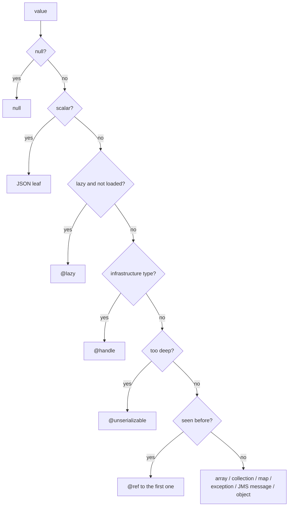

# Serialization

This document explains how the agent turns the Java objects a call received and returned (arguments, results, exceptions, JMS messages) into JSON. It covers the rules, the order of decisions, and the limits. The exact JSON shape of every marker is in [TRACE-FORMAT.md](../TRACE-FORMAT.md#markers); this document covers *when* each marker is used and why.

## The rules

1. **Record what crossed the boundary, unchanged.** Every field, no masking, no allow-lists or deny-lists. If something is left out, the output says what and why, with a marker.
2. **Never change the application's state.** No getters, no `toString` on entities, no lazy loading. The serializer reads fields directly, so serializing an object can't trigger a database query or change the object.
3. **Never throw.** A failure anywhere in the walk becomes an `@unserializable` marker and a warning on the span. The rest of the value is still written.
4. **Never confuse class loaders.** Types are recognised by name through the value's own class hierarchy, never resolved through the agent's loader ([CONCEPTS.md](CONCEPTS.md#class-loaders)).

## Who does what

| class | job |
| --- | --- |
| [`GraphSerializer`][GraphSerializer] | the interface recorders call: value in, JSON tree out, never throws |
| [`JacksonGraphSerializer`][JacksonGraphSerializer] | the object walk. Jackson supplies the JSON tree classes only; no `ObjectMapper` and no getters are involved. |
| [`SerializationContext`][SerializationContext] | per-value state: the current path (`$.args[0].lines[2]`), the identity table for `@id`/`@ref`, the depth, the warnings |
| [`TypeInfo`][TypeInfo], [`TypeInfoCache`][TypeInfoCache] | per-class facts, computed once: fields to walk, fields to skip and why, whether it's an entity, lazy wrapper, handle or JMS message |
| [`Scalars`][Scalars] | leaf values: strings, numbers, dates, enums, UUIDs, ... |
| [`LazyState`][LazyState] | whether a JPA lazy value is loaded, without loading it |
| [`InfrastructureTypes`][InfrastructureTypes] | types recorded as a reference instead of walked |
| [`JmsMessageView`][JmsMessageView] | JMS messages, through the JMS API |
| [`SerializationCeilings`][SerializationCeilings] | the size limits |
| [`Marker`][Marker] | the names of the markers |

Each argument, the result and the exception are serialized separately, with their own context, so `@id`/`@ref` numbers never cross from one to another.

## How a value is walked

[`JacksonGraphSerializer.write`][JacksonGraphSerializer] decides in this order:

1. **Scalars** become plain JSON. Numbers are exact: `BigDecimal` and `BigInteger` are written as strings, so no precision is lost. Dates and times are written in ISO format, and a `java.sql.Timestamp` keeps its nanoseconds. Enums are written by name. Strings over the length limit become `@text` with a prefix and the full length.
2. **Lazy JPA values** that aren't loaded become `@lazy` ([below](#jpa-entities-and-lazy-values)).
3. **Infrastructure types** become `@handle` ([below](#handles)).
4. **Depth.** Past 64 levels, the subtree becomes `@unserializable`.
5. **Identity.** An object seen earlier in the same value isn't written twice. The first occurrence gets `@id`, and later ones are written as `{"@ref": n}`. That's what makes cycles (parent ↔ child) and shared objects safe. A collection that contains itself while it's still being written is cut with `@unserializable`.
6. **By kind:**
   - **arrays and collections** become JSON arrays. A `byte[]` becomes `@bytes` (base64), and a `char[]` becomes a string.
   - **maps** with scalar keys become JSON objects. Other maps become `@entries`, a list of key/value pairs, so no key is lost to `toString`.
   - **exceptions** are walked like objects, plus their full stack trace as text. JVM-internal frame data is skipped.
   - **JMS messages** are written by [`JmsMessageView`][JmsMessageView] ([below](#jms-messages)).
   - **everything else** becomes a JSON object with `@type` (the runtime class) and every instance field, from the top superclass down. A class that isn't `Serializable` is flagged `@serializable: false`, which tells you the value couldn't cross a remote call as it is.

### Fields that are skipped

[`TypeInfo`][TypeInfo] decides once per class. A skipped field is listed in the object's `@skipped` with its reason:

| field | reason |
| --- | --- |
| compiler-generated (synthetic, or `$` in the name) | not part of the program's data |
| `_persistence_*` | added by the EclipseLink weaver; a `_vh` holder's state is reported on the field it backs |
| `$$_hibernate_*` | added by the Hibernate weaver |
| a field `setAccessible` refuses | JDK module encapsulation without the matching `--add-opens`; the reason names the exception |

Static fields aren't walked. Transient fields are, because they crossed the call.

## JPA entities and lazy values

A JPA entity can hold a collection or reference that hasn't been loaded from the database yet. Reading it normally would run a query in the middle of the business call, or fail outside its transaction. [`LazyState`][LazyState] asks the lazy wrapper itself whether it's loaded, by name and reflectively:

| provider | wrapper | asks |
| --- | --- | --- |
| EclipseLink | `IndirectContainer` (lazy collections) | `isInstantiated()` |
| EclipseLink | `ValueHolderInterface`, and woven `_persistence_<field>_vh` holders | `isInstantiated()` |
| Hibernate | `PersistentCollection` | `wasInitialized()` |
| Hibernate | `HibernateProxy` | `getHibernateLazyInitializer().isUninitialized()` |

- **Loaded:** the value is walked as normal.
- **Not loaded:** it becomes `{"@lazy": true, "loaded": false}`.
- **Can't tell:** it becomes `@lazy` with a warning; it's never touched.

`toString` is never called on an entity or a lazy wrapper, because it could load them.

## Handles

Some objects describe the JVM or the operating system rather than data: threads, class loaders, sockets, streams, JDBC connections, locks, executors. Walking their fields would produce pages of JVM internals and could block. [`InfrastructureTypes`][InfrastructureTypes] lists them by name; each becomes a `@handle` with its kind, its class and identity hash, and its `toString`, plus a warning on the span.

This list is about what is *meaningful*, not what is *sensitive*. Loggers, framework and container objects are walked like anything else.

## JMS messages

A JMS message object's own fields describe the vendor's session and buffers, not the message. [`JmsMessageView`][JmsMessageView] writes the message as the JMS API sees it instead:

- `@jms`: the message type (`TextMessage`, `MapMessage`, `ObjectMessage`, ...);
- `headers`: message id, correlation id, timestamp, type, delivery mode, priority, expiration, redelivered, destination, reply-to;
- `properties`: every property;
- the body: `text`, `map` or `object`.

A `BytesMessage` or `StreamMessage` body isn't read, because reading it consumes it and the bean would then receive an empty message. The span records the body length and a `@truncated` reason instead.

## Limits

[`SerializationCeilings`][SerializationCeilings]:

| limit | default | when exceeded |
| --- | --- | --- |
| nesting depth | 64 | the subtree becomes `@unserializable` |
| elements per collection, map or array | 100,000 | a final `@truncated` entry with the number dropped |
| characters per string | 16 Mi | `@text` with the first part, the full length and the number dropped |
| bytes per `byte[]` | 64 MiB | `@bytes` with the first part, the full length and the number dropped |

HTTP bodies have their own limit of 64 MiB per body ([HOOKS.md](HOOKS.md#servlet-pipeline)).

## Warnings

Everything the walk leaves out or can't read is also added to the span's `serializationWarnings`, with the path, the reason and the type: handles, unknown lazy state, every limit reached, cycles, inaccessible fields, failures, unread JMS bodies. The viewer shows them as "Notes from the capture".

## JDK 9+ and `--add-opens`

Walking a JDK class's fields (`ArrayList.elementData`, `BigDecimal.intVal`, ...) needs the JDK package to be open to the agent. On a JDK 9+ domain, `wltrace:enable` opens the packages that hold common value types (the list is in [PLUGIN.md](PLUGIN.md#the-overrides-block)). A field in any other closed package is listed in `@skipped` as inaccessible. The agent's tests run with the same flags.

[GraphSerializer]: ../../weblogic-trace-agent/src/main/java/ca/gc/cra/xz02/devops/wltrace/agent/serialize/GraphSerializer.java
[JacksonGraphSerializer]: ../../weblogic-trace-agent/src/main/java/ca/gc/cra/xz02/devops/wltrace/agent/serialize/JacksonGraphSerializer.java
[SerializationContext]: ../../weblogic-trace-agent/src/main/java/ca/gc/cra/xz02/devops/wltrace/agent/serialize/SerializationContext.java
[TypeInfo]: ../../weblogic-trace-agent/src/main/java/ca/gc/cra/xz02/devops/wltrace/agent/serialize/TypeInfo.java
[TypeInfoCache]: ../../weblogic-trace-agent/src/main/java/ca/gc/cra/xz02/devops/wltrace/agent/serialize/TypeInfoCache.java
[Scalars]: ../../weblogic-trace-agent/src/main/java/ca/gc/cra/xz02/devops/wltrace/agent/serialize/Scalars.java
[LazyState]: ../../weblogic-trace-agent/src/main/java/ca/gc/cra/xz02/devops/wltrace/agent/serialize/LazyState.java
[InfrastructureTypes]: ../../weblogic-trace-agent/src/main/java/ca/gc/cra/xz02/devops/wltrace/agent/serialize/InfrastructureTypes.java
[JmsMessageView]: ../../weblogic-trace-agent/src/main/java/ca/gc/cra/xz02/devops/wltrace/agent/serialize/JmsMessageView.java
[SerializationCeilings]: ../../weblogic-trace-agent/src/main/java/ca/gc/cra/xz02/devops/wltrace/agent/serialize/SerializationCeilings.java
[Marker]: ../../weblogic-trace-agent/src/main/java/ca/gc/cra/xz02/devops/wltrace/agent/serialize/Marker.java
