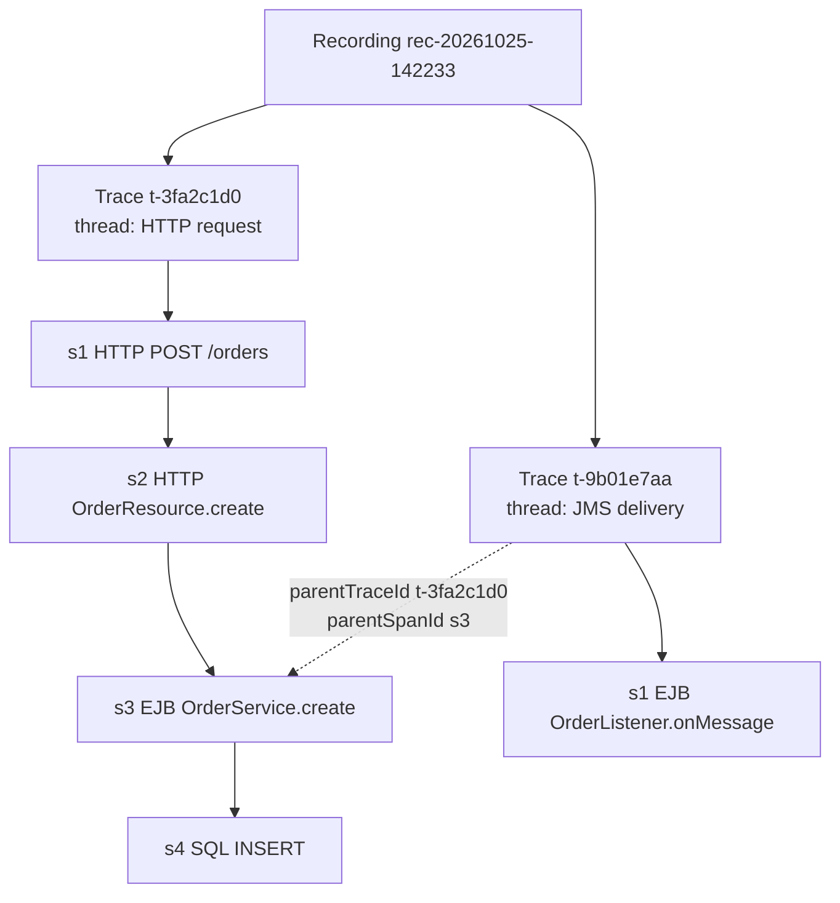
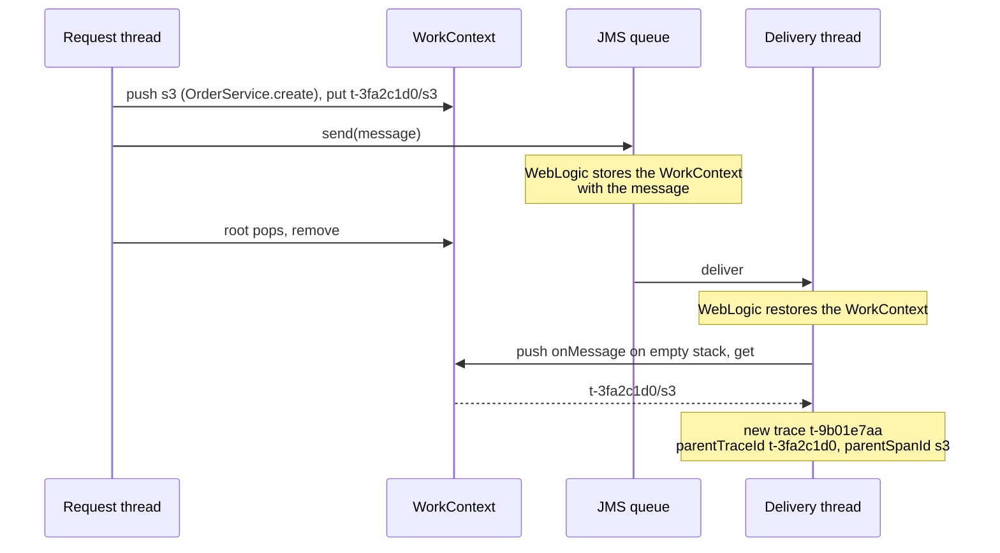

# How calls become traces

This document explains how the agent turns intercepted calls into traces: when a trace starts and ends, how spans are linked to each other, how work that moves to another thread (an `@Asynchronous` call, a JMS message to an MDB) is linked back to what caused it, and how traces reach the disk. It starts where [FRAMEWORK.md](FRAMEWORK.md#recorders) leaves off: a recorder's `enter` and `exit` are being called.

## Recording, trace, span



- A **span** is one recorded call ([`OpenSpan`][OpenSpan] while it runs, [`Span`][Span] when it's done).
- A **trace** is every span one thread recorded for one outermost call ([`OpenTrace`][OpenTrace], then [`Trace`][Trace]). One trace is one file.
- A **recording** is every trace written between Start and Stop ([`Recording`][Recording]). One recording is one directory.

Inside a trace, spans are linked by `parentId`. Between traces, a trace started by another trace's work names its cause with `parentTraceId` and `parentSpanId`.

## One stack per thread

Each thread has its own [`SpanStack`][SpanStack], kept in a `ThreadLocal` by [`SpanStacks`][SpanStacks]. A thread runs one call at a time, and calls nest, so a stack is all it takes:

- `enter` pushes a span. The span below it on the stack is its parent.
- `exit` pops it. Exits arrive in the reverse order of entries, because methods return in that order.

No locking is needed: a stack is only ever touched by its own thread.

## When a trace starts and ends

**Starts:** when a span is pushed on an **empty** stack. That span is the root, and a new [`OpenTrace`][OpenTrace] is created with:
- `id`: `t-` plus 8 random hex characters;
- the start time, and the clock origin every span's `startNs` is measured from;
- the cause, if another thread's work handed this one over ([below](#work-that-continues-on-another-thread));
- the caller's principal and HTTP session id, read before the push.

Any hook can produce a root. Usually it's the HTTP request; for a remote EJB call from outside the server it's the EJB span; for a JMS delivery it's the MDB span.

**Ends:** when the root is popped and the stack is empty again. `OpenTrace.build` assembles the [`Trace`][Trace]: recording id and name, server name, the domain's deployments, and the spans sorted by `order`. The trace goes to the [writer](#writing-traces-to-disk), and the stack is ready for the next request on that thread.

## How spans are linked

[`SpanStack.push`][SpanStack] gives every span:

| field | value | example |
| --- | --- | --- |
| `id` | `s` + its position in entry order, starting at 1 | `s3` |
| `order` | entry order within the trace, from 0 | `2` |
| `parentId` | `id` of the span on top of the stack at push; none for the root | `s2` |
| `depth` | parent's depth + 1; root is 0 | `2` |
| `startNs` | nanoseconds since the trace started | `1834000` |
| `durationNs` | set at exit | `52000000` |
| `thread` | the thread's name | `[ACTIVE] ExecuteThread: '3' ...` |

Spans are completed inner-first, and the file lists them sorted by `order`, so a reader can rebuild the call tree from `parentId` alone.

## Matching exit to entry: the token

`enter` returns a token, a number unique within the thread's stack. The advice keeps it in a local variable of the instrumented method and passes it to `exit`. `exit` closes the span only if the token matches the top of the stack.

A mismatch means the stack no longer reflects the calls running on this thread, which happens when a recording starts or stops mid-call. The stack is reset, nothing is written for those spans, and the next call starts a clean trace. `NOT_RECORDED` (`0`) means `enter` opened nothing, and `exit` returns at once.

## Recording boundaries

- **A call that was already running when Start was pressed** isn't recorded. Its `enter` ran before the recording existed. Calls it makes after Start become roots of their own traces.
- **A call still running when Stop is pressed** completes normally: a method already running keeps the bytecode it started with, advice included. Its trace is written to the stopped recording's directory, after that server's manifest was completed, so the manifest's `traceCount` doesn't include it.
- **A new recording started while spans are still open** on a thread: the next push sees the trace belongs to another recording, drops the stale spans and starts fresh. The stale exits then miss on their tokens.

## Work that continues on another thread

When a bean sends a JMS message, the MDB receives it later, on another thread with an empty stack. That's a new trace. To link it to its cause, the agent uses WebLogic's WorkContext ([CONCEPTS.md](CONCEPTS.md#workcontext)), a set of entries WebLogic carries along with the work.

[`WorkContextPropagation`][WorkContextPropagation] keeps one entry, `ca.gc.cra.xz02.devops.wltrace` = `<traceId>/<spanId>`:

| when | what happens to the entry |
| --- | --- |
| every push | set to the new top span: "this span is running now" |
| every pop that leaves spans open | set back to the new top span |
| the root pops | removed |
| a push on an empty stack | read first; if present, it becomes the new trace's `parentTraceId` and `parentSpanId` |



The entry is written with the propagation modes `LOCAL`, `WORK`, `RMI`, `JMS_QUEUE`, `JMS_TOPIC`, `SOAP` and `MIME_HEADER`. `WORK` is what carries it to the thread an `@Asynchronous` method runs on; WebLogic's `GLOBAL` mode doesn't include it. Linking covers `@Asynchronous` calls and JMS deliveries within one server.

If the WorkContext API can't be found, the agent logs it once, and traces on other threads are recorded unlinked.

**In the viewer**, [`diagram.js`][diagram] looks up each trace's `parentTraceId` among the recording's traces and draws the child under the span named by `parentSpanId` (or the parent's root, if that span isn't found). A trace whose parent isn't in the recording is drawn as an entry point.

## Writing traces to disk

[`TraceWriter`][TraceWriter] decouples the request thread from the disk:

- `offer` stamps the trace with the recording's next sequence number and puts it on a bounded queue of 1000. If the queue is full, the trace is dropped and counted (`DroppedTraces` on the MBean, `droppedTraces` in the manifest). The request thread never blocks.
- One daemon thread, `weblogic-trace-writer`, takes traces off the queue and writes each to `<seq>-<traceId>.json.tmp`, then renames it to `<seq>-<traceId>.json`. A reader never sees a half-written file.
- `agent.log` gets one `TRACE` line per file: id, sequence, root, span count, duration, principal.

[`ManifestWriter`][ManifestWriter] writes `recording-<server>.json` at Start and completes it at Stop with the end time, the trace count and the dropped count.

```
<out>/
├── agent.log
└── rec-20261025-142233/            one recording
    ├── recording-AdminServer.json  one manifest per server
    ├── recording-ms1.json
    ├── 000001-t-3fa2c1d0.json      one file per trace
    └── 000002-t-9b01e7aa.json
```

The file format is in [TRACE-FORMAT.md](../TRACE-FORMAT.md).

## Several servers

The plugin generates one recording id and calls `start` with it on every server of the domain ([PLUGIN.md](PLUGIN.md#starting-a-recording)). Each server writes its traces and its own manifest into the directory of that id. Sequence numbers are per server, so two files from different servers can share a number; the trace id keeps file names apart. The viewer merges the manifests ([VIEWER.md](VIEWER.md#reading-recordings)).

## A worked example

A browser sends `POST /orders` to an application (its class names here are illustrative). A JAX-RS resource, OrderResource, calls the session bean OrderService.create, which inserts a row and sends a JMS message. An MDB receives the message.

| # | where | what the agent does | class |
| --- | --- | --- | --- |
| 1 | `FilterChainImpl.doFilter` | Empty stack: new trace `t-3fa2c1d0`. Push `s1` (HTTP). Swap request and response for tee wrappers. WorkContext = `t-3fa2c1d0/s1`. | [`ServletRecorder`][ServletRecorder] |
| 2 | OrderResource.create | Push `s2` (HTTP, `jaxrs`) under `s1`. | [`ResourceRecorder`][ResourceRecorder] |
| 3 | `SessionLocalMethodInvoker.invoke` | Push `s3` (EJB) under `s2`. WorkContext = `t-3fa2c1d0/s3`. | [`EjbRecorder`][EjbRecorder] |
| 4 | `PreparedStatement.executeUpdate` | Push `s4` (SQL) with the bound parameters; pop it with the update count. WorkContext back to `s3`. | [`JdbcRecorder`][JdbcRecorder] |
| 5 | JMS send in `create` | No hook. WebLogic stores the WorkContext, `t-3fa2c1d0/s3`, with the message. | |
| 6 | `create` returns | Pop `s3` with arguments and result. | [`EjbRecorder`][EjbRecorder] |
| 7 | the resource returns | Pop `s2`. | [`ResourceRecorder`][ResourceRecorder] |
| 8 | the filter chain returns | Read status, headers and both bodies; pop `s1`. Stack empty: the trace is built and queued; WorkContext cleared. | [`ServletRecorder`][ServletRecorder], [`TraceWriter`][TraceWriter] |
| 9 | `MDListener.onMessage`, delivery thread | Empty stack: read WorkContext `t-3fa2c1d0/s3`. New trace `t-9b01e7aa` with that parent. Push `s1` (EJB, `MESSAGE`). | [`MessageRecorder`][MessageRecorder] |
| 10 | `onMessage` returns | Pop `s1`: the second trace is queued. | [`MessageRecorder`][MessageRecorder] |

The viewer draws the second trace under `s3` of the first, as a send to the queue followed by the delivery.

## Edge cases

- **Row counts after the span closes.** An SQL span is closed when `executeQuery` returns, but its rows are counted as the application reads them afterwards. If the trace is written before reading finishes, the file has the count so far.
- **Reset doesn't clear WorkContext.** When a stack is reset after a token mismatch or a failed exit, the WorkContext entry from that thread's last span stays. If the same unit of work then hands off to another thread, the child names a span that was never written.

[diagram]: ../../weblogic-trace-viewer/src/main/resources/ca/gc/cra/xz02/devops/wltrace/viewer/web/diagram.js
[Span]: ../../weblogic-trace-model/src/main/java/ca/gc/cra/xz02/devops/wltrace/model/Span.java
[Trace]: ../../weblogic-trace-model/src/main/java/ca/gc/cra/xz02/devops/wltrace/model/Trace.java
[OpenSpan]: ../../weblogic-trace-agent/src/main/java/ca/gc/cra/xz02/devops/wltrace/agent/record/OpenSpan.java
[OpenTrace]: ../../weblogic-trace-agent/src/main/java/ca/gc/cra/xz02/devops/wltrace/agent/record/OpenTrace.java
[Recording]: ../../weblogic-trace-agent/src/main/java/ca/gc/cra/xz02/devops/wltrace/agent/record/Recording.java
[SpanStack]: ../../weblogic-trace-agent/src/main/java/ca/gc/cra/xz02/devops/wltrace/agent/record/SpanStack.java
[SpanStacks]: ../../weblogic-trace-agent/src/main/java/ca/gc/cra/xz02/devops/wltrace/agent/record/SpanStacks.java
[TraceWriter]: ../../weblogic-trace-agent/src/main/java/ca/gc/cra/xz02/devops/wltrace/agent/record/TraceWriter.java
[ManifestWriter]: ../../weblogic-trace-agent/src/main/java/ca/gc/cra/xz02/devops/wltrace/agent/record/ManifestWriter.java
[ServletRecorder]: ../../weblogic-trace-agent/src/main/java/ca/gc/cra/xz02/devops/wltrace/agent/record/ServletRecorder.java
[ResourceRecorder]: ../../weblogic-trace-agent/src/main/java/ca/gc/cra/xz02/devops/wltrace/agent/record/ResourceRecorder.java
[EjbRecorder]: ../../weblogic-trace-agent/src/main/java/ca/gc/cra/xz02/devops/wltrace/agent/record/EjbRecorder.java
[MessageRecorder]: ../../weblogic-trace-agent/src/main/java/ca/gc/cra/xz02/devops/wltrace/agent/record/MessageRecorder.java
[JdbcRecorder]: ../../weblogic-trace-agent/src/main/java/ca/gc/cra/xz02/devops/wltrace/agent/record/JdbcRecorder.java
[WorkContextPropagation]: ../../weblogic-trace-agent/src/main/java/ca/gc/cra/xz02/devops/wltrace/agent/weblogic/WorkContextPropagation.java
