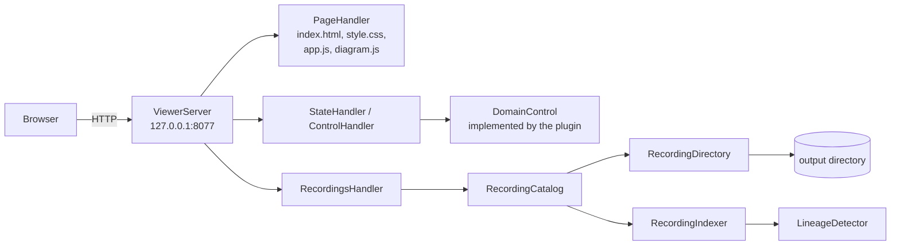

# The viewer

This document explains the viewer: the small web server `wltrace:start` runs, how it reads recordings from disk, how it works out lineage, and how the page draws a recording as a sequence diagram. The viewer only reads files and forwards Start and Stop; it knows nothing about domains or JVMs.

## Shape

- [`ViewerServer`][ViewerServer] uses the JDK's built-in `com.sun.net.httpserver`, bound to `127.0.0.1` only, with four worker threads. There's no web framework.
- [`DomainControl`][DomainControl] is the only thing the viewer knows about the domain: get the state, start, stop. The plugin implements it ([`MonitoredDomainControl`][MonitoredDomainControl]); a test can implement it with a stub.

## Endpoints

| path | method | handler | returns |
| --- | --- | --- | --- |
| `/`, `/index.html`, `/style.css`, `/app.js`, `/diagram.js` | GET | [`PageHandler`][PageHandler] | the page files, from the classpath |
| `/api/state` | GET | [`StateHandler`][StateHandler] | the domain state and each server ([`ControlState`][ControlState]) |
| `/api/control/start` | POST | [`ControlHandler`][ControlHandler] | starts a recording, optional body `{"name": ...}`; `409` when refused |
| `/api/control/stop` | POST | [`ControlHandler`][ControlHandler] | `{"stopped": [ids]}` |
| `/api/recordings` | GET | [`RecordingsHandler`][RecordingsHandler] | every recording, newest first |
| `/api/recordings/{id}` | GET | [`RecordingsHandler`][RecordingsHandler] | the recording's index: manifest, one summary per trace, lineage |
| `/api/recordings/{id}` | DELETE | [`RecordingsHandler`][RecordingsHandler] | deletes it; `409` for the active recording |
| `/api/recordings/{id}/traces/{file}` | GET | [`RecordingsHandler`][RecordingsHandler] | one trace file, as written |

Every JSON response goes through [`JsonHandler`][JsonHandler]: `Cache-Control: no-store`, and an exception becomes `500 {"error": ...}`. Recording ids must match `[A-Za-z0-9._-]+`, so a request can't reach outside the output directory.

## Reading recordings

[`RecordingCatalog`][RecordingCatalog] lists the subdirectories of the output directory that hold a manifest or a trace file.

[`RecordingDirectory`][RecordingDirectory] reads one of them:
- **trace files** match `NNNNNN-t-<hex>.json` and are sorted by start time, then sequence number;
- **manifests** (`recording.json` or `recording-<server>.json`, one per server) are merged into one: the earliest start, the latest end (none while any server is still recording), the summed trace and dropped counts, and the list of servers. A directory without a manifest gets one made up from its name.

[`RecordingIndexer`][RecordingIndexer] builds the [`RecordingIndex`][RecordingIndex] the page loads first: the merged manifest, one summary per trace (id, file, start, duration, principal, parent ids, a root label from [`SpanNames`][SpanNames], span and warning counts, whether the root failed), and the lineage entries.

The catalog caches each index in memory, keyed on the directory's newest modification time and file count. A recording that is still being written is re-indexed as files arrive, and the page polls for the new ones.

## Lineage

Lineage answers "where did this value come from?" For example, a confirm request receives order id `10045`; that id was returned by an earlier create call. The agent records values only; the viewer works out the links afterwards, in [`viewer/recording/lineage`][lineage]. The result is returned with the index and never written to disk.

1. **Flatten** ([`ValueFlattener`][ValueFlattener]). Each span's values become `(path, value)` pairs:
   - **inputs:** `args[i]`, the request body, and for a root HTTP span the URL path segments and query values;
   - **outputs:** `result` and the response body.

   JSON bodies are parsed, XML bodies (SOAP) are read by [`XmlBodies`][XmlBodies] into the same shape, and markers are skipped.
2. **Keep only distinctive values** ([`DistinctiveValues`][DistinctiveValues]): UUIDs, ISO dates and times, numbers of 1000 or more or with decimals, small integers only under an id-like name (`id`, `orderId`, `*_id`, `*Key`, `*Number`, `*Ref`, ...), and strings of 6+ characters that aren't a single word. `true`, `0` or `"OK"` would link everything to everything.
3. **Match, in trace order** ([`LineageDetector`][LineageDetector]). For each input, look for the same value among earlier outputs. The nearest earlier source wins, and the others are listed as alternatives. Then add this trace's outputs to the sources.
4. **Classify what has no source:**
   - **user input:** it first appeared in an entry point's request, so the user typed it. Once seen there, the value is never linked again.
   - **environment:** it appears only in nested calls, or is a timestamp within the trace's own time window, so the server produced it.
5. **Ignore common values.** A value produced by more than 5 different traces stops being a source.

## The page

Four plain files in [`viewer/web`][web], no build step:

| file | owns |
| --- | --- |
| [`index.html`][index] | the frame: state bar, recordings list, diagram area, details window |
| [`style.css`][style] | the look |
| [`app.js`][app] | state polling, routing by URL hash (`#r=<recording>&t=<trace>&s=`), loading traces, the details window, lineage badges, Start, Stop and Delete |
| [`diagram.js`][diagram] | turning a recording into a sequence diagram, and drawing it as SVG |

### How the diagram is built

`buildModel()` in [`diagram.js`][diagram]:

1. **Rebuild the trees.** Each trace's spans are linked by `parentId`.
2. **Attach child traces.** A trace with a `parentTraceId` from this recording is attached under the span named by `parentSpanId` ([TRACING.md](TRACING.md#work-that-continues-on-another-thread)). Traces left without a parent are the entry points, numbered by start time.
3. **Make lanes.** One per component: client, REST or SOAP resource, each bean (by type: stateless, stateful, singleton, EJB 2.x, MDB), each JMS destination, each data source. Lanes are grouped under their application; a resource takes the application of the beans it calls.
4. **Make rows.** Each call is one row, and its return is another, in time order. A child trace appears where it was caused: a JMS child as a send to the queue's lane, then the delivery to the MDB; an `@Asynchronous` child with a tag.
5. **Fold repeats.** Four or more identical calls in a row with no children (the same SQL in a loop, for example) become one `×N` row that can be expanded.

`render()` draws the lanes, activation bars, call and return arrows, failures in red, tags (status, rows, `REMOTE`, `truncated`) and durations.

### The details window

Clicking a row opens the call's details: the chain of calls that led to it, including thread hops; its facts (bean, interface, signature, JNDI names, data source, request); the input, output and exception as foldable JSON trees; the HTTP exchange; and "Notes from the capture" (the span's serialization warnings). Markers are highlighted and explained on hover. Lineage badges show where an input came from, or where an output went, and clicking one jumps there.

[ViewerServer]: ../../weblogic-trace-viewer/src/main/java/ca/gc/cra/xz02/devops/wltrace/viewer/web/ViewerServer.java
[DomainControl]: ../../weblogic-trace-viewer/src/main/java/ca/gc/cra/xz02/devops/wltrace/viewer/web/DomainControl.java
[ControlState]: ../../weblogic-trace-viewer/src/main/java/ca/gc/cra/xz02/devops/wltrace/viewer/web/ControlState.java
[PageHandler]: ../../weblogic-trace-viewer/src/main/java/ca/gc/cra/xz02/devops/wltrace/viewer/web/PageHandler.java
[StateHandler]: ../../weblogic-trace-viewer/src/main/java/ca/gc/cra/xz02/devops/wltrace/viewer/web/StateHandler.java
[ControlHandler]: ../../weblogic-trace-viewer/src/main/java/ca/gc/cra/xz02/devops/wltrace/viewer/web/ControlHandler.java
[RecordingsHandler]: ../../weblogic-trace-viewer/src/main/java/ca/gc/cra/xz02/devops/wltrace/viewer/web/RecordingsHandler.java
[JsonHandler]: ../../weblogic-trace-viewer/src/main/java/ca/gc/cra/xz02/devops/wltrace/viewer/web/JsonHandler.java
[RecordingCatalog]: ../../weblogic-trace-viewer/src/main/java/ca/gc/cra/xz02/devops/wltrace/viewer/recording/RecordingCatalog.java
[RecordingDirectory]: ../../weblogic-trace-viewer/src/main/java/ca/gc/cra/xz02/devops/wltrace/viewer/recording/RecordingDirectory.java
[RecordingIndexer]: ../../weblogic-trace-viewer/src/main/java/ca/gc/cra/xz02/devops/wltrace/viewer/recording/RecordingIndexer.java
[SpanNames]: ../../weblogic-trace-viewer/src/main/java/ca/gc/cra/xz02/devops/wltrace/viewer/recording/SpanNames.java
[lineage]: ../../weblogic-trace-viewer/src/main/java/ca/gc/cra/xz02/devops/wltrace/viewer/recording/lineage
[ValueFlattener]: ../../weblogic-trace-viewer/src/main/java/ca/gc/cra/xz02/devops/wltrace/viewer/recording/lineage/ValueFlattener.java
[XmlBodies]: ../../weblogic-trace-viewer/src/main/java/ca/gc/cra/xz02/devops/wltrace/viewer/recording/lineage/XmlBodies.java
[DistinctiveValues]: ../../weblogic-trace-viewer/src/main/java/ca/gc/cra/xz02/devops/wltrace/viewer/recording/lineage/DistinctiveValues.java
[LineageDetector]: ../../weblogic-trace-viewer/src/main/java/ca/gc/cra/xz02/devops/wltrace/viewer/recording/lineage/LineageDetector.java
[RecordingIndex]: ../../weblogic-trace-model/src/main/java/ca/gc/cra/xz02/devops/wltrace/model/RecordingIndex.java
[MonitoredDomainControl]: ../../weblogic-trace-maven-plugin/src/main/java/ca/gc/cra/xz02/devops/wltrace/plugin/jvm/MonitoredDomainControl.java
[web]: ../../weblogic-trace-viewer/src/main/resources/ca/gc/cra/xz02/devops/wltrace/viewer/web
[index]: ../../weblogic-trace-viewer/src/main/resources/ca/gc/cra/xz02/devops/wltrace/viewer/web/index.html
[style]: ../../weblogic-trace-viewer/src/main/resources/ca/gc/cra/xz02/devops/wltrace/viewer/web/style.css
[app]: ../../weblogic-trace-viewer/src/main/resources/ca/gc/cra/xz02/devops/wltrace/viewer/web/app.js
[diagram]: ../../weblogic-trace-viewer/src/main/resources/ca/gc/cra/xz02/devops/wltrace/viewer/web/diagram.js
